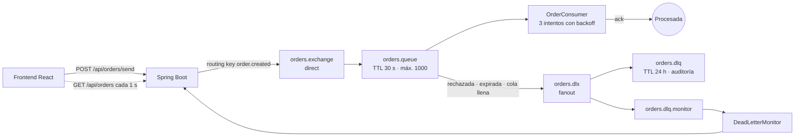

# Procesador de órdenes con DLX/DLQ, TTL y alertas

Sistema de ejemplo que muestra cómo un servicio procesa mensajes de RabbitMQ sin perder ninguno cuando algo falla.

Un backend en Spring Boot consume órdenes y simula fallos aleatorios. Cada orden se reintenta con backoff exponencial y, si sigue fallando, RabbitMQ la mueve a una **Dead Letter Queue** (DLQ) donde queda en cuarentena para revisarla. Un panel en React muestra en tiempo real el estado de cada orden y lanza alertas cuando una termina en la DLQ.

Implementa la guía **"DLX/DLQ, políticas de retención y alertas"** y corrige algunos puntos que en la guía original no funcionan (ver [Diferencias con la guía](#diferencias-con-la-guía)).

   

---

## Contenido

- [Cómo funciona](#cómo-funciona)
- [Requisitos](#requisitos)
- [Inicio rápido](#inicio-rápido)
- [Cómo usarlo](#cómo-usarlo)
- [Qué mirar en RabbitMQ Management](#qué-mirar-en-rabbitmq-management)
- [Configuración](#configuración)
- [API REST](#api-rest)
- [Estructura del proyecto](#estructura-del-proyecto)
- [Conceptos implementados](#conceptos-implementados)
- [Diferencias con la guía](#diferencias-con-la-guía)
- [Solución de problemas](#solución-de-problemas)
- [Referencias](#referencias)

---

## Cómo funciona



1. El frontend publica una orden a través de la API. El backend la envía a `orders.exchange` con un `messageId` único.
2. `orders.queue` la entrega a `OrderConsumer`, que tarda 0,8 s en "procesarla" y falla con un 50 % de probabilidad.
3. Si falla, Spring Retry la reintenta en el mismo consumidor: espera 1 s, reintenta, espera 2 s, reintenta.
4. Si el tercer intento también falla, el mensaje se rechaza (`basicNack` con `requeue=false`) y RabbitMQ lo reenvía al **Dead Letter Exchange** `orders.dlx`.
5. `orders.dlx` es de tipo fanout, así que copia el mensaje a dos colas:
   - `orders.dlq`: nadie la consume. Guarda los mensajes 24 h para auditoría.
   - `orders.dlq.monitor`: la consume la app para marcar la orden como fallida y disparar la alerta en el panel.

Una orden llega a la DLQ por cualquiera de estos tres motivos (RabbitMQ lo indica en el header `x-first-death-reason`):

| Motivo | Cuándo ocurre | Cómo provocarlo |
|---|---|---|
| `rejected` | Se agotaron los 3 intentos | Botón **Orden defectuosa** |
| `expired` | Pasó más de 30 s en `orders.queue` sin que nadie la tomara | Botón **Ráfaga de 20** |
| `maxlen` | `orders.queue` superó los 1000 mensajes y se descartó la más antigua | Enviar más de 1000 órdenes con el backend detenido |

### Ciclo de vida de una orden

| Estado | Significado |
|---|---|
| **Enviada** | Publicada en RabbitMQ, esperando en `orders.queue` |
| **Procesando** | El consumidor la está procesando (intento en curso) |
| **Reintentando** | Un intento falló y está esperando el backoff antes del siguiente |
| **Procesada** | Se confirmó con `basicAck`. RabbitMQ la elimina de la cola |
| **En DLQ** | Terminó en la Dead Letter Queue. El panel muestra el motivo |

---

## Requisitos

| Herramienta | Versión | Para qué |
|---|---|---|
| Docker Desktop | Cualquiera reciente | Levantar RabbitMQ |
| Java (JDK) | 17 o superior | Ejecutar el backend |
| Node.js | 20.19 o superior | Ejecutar el frontend |

No necesitas instalar Maven: el backend incluye Maven Wrapper (`mvnw` / `mvnw.cmd`), que lo descarga la primera vez.

---

## Inicio rápido

Abre tres terminales en la raíz del proyecto.

**1. RabbitMQ**

```bash
docker compose up -d
```

Espera unos 15 segundos a que arranque. El panel de administración queda en http://localhost:15672 (usuario `guest`, contraseña `guest`).

**2. Backend** (puerto 8080)

```bash
cd order-processor-dlq
./mvnw spring-boot:run        # Linux, macOS o Git Bash
mvnw.cmd spring-boot:run      # CMD o PowerShell en Windows
```

Al arrancar, Spring declara automáticamente los exchanges, colas y bindings. No hay que crear nada a mano en RabbitMQ.

**3. Frontend** (puerto 5173)

```bash
cd vite-order-app
npm install
npm run dev
```

Abre http://localhost:5173. Si arriba a la derecha aparece **"Backend y RabbitMQ conectados"**, todo está listo.

### Detener todo

```bash
# Ctrl + C en las terminales del backend y del frontend, luego:
docker compose down        # conserva los mensajes
docker compose down -v     # borra también el volumen con las colas
```

---

## Cómo usarlo

El panel tiene tres zonas: los botones para enviar órdenes (izquierda), los contadores y el historial (derecha), y las alertas flotantes (abajo a la derecha).

### Escenario 1: orden normal

Pulsa **Orden cliente 1**. En el historial verás la orden pasar por *Enviada*, *Procesando* y, según la suerte, *Reintentando*. Los puntos naranjas indican cuántos intentos lleva (máximo 3).

- Con un 50 % de fallo por intento, aproximadamente 7 de cada 8 órdenes terminan **Procesadas**.
- La restante (12,5 %) agota los 3 intentos y termina **En DLQ** con el motivo *"Rechazada tras agotar los reintentos"*.

En la terminal del backend verás cada paso:

```
[PROCESADOR] ORD-1759150000001 intento 1/3: Orden ID: ORD-1759150000001 | Cliente: Juan Pérez | Hora: 11:20:05
[ERROR] ORD-1759150000001 Error simulado en el intento 1
[PROCESADOR] ORD-1759150000001 intento 2/3: ...
[EXITO] ORD-1759150000001 procesada en el intento 2
```

### Escenario 2: orden defectuosa

Pulsa **Orden defectuosa**. Esta orden lleva el header `x-force-fail: true`, así que falla siempre. En unos 5 segundos (3 intentos más 1 s y 2 s de espera) verás:

- La orden en rojo con estado **En DLQ**.
- Una alerta flotante: *"ORD-... enviada a la DLQ"*.
- El contador de `orders.dlq` subir en 1.

### Escenario 3: ráfaga para ver el TTL

Pulsa **Ráfaga de 20**. Se publican 20 órdenes de golpe. Como el consumidor procesa de a una (`prefetch: 1`) y cada orden puede tardar varios segundos entre intentos, las últimas de la fila superan los **30 s de TTL** antes de ser atendidas. RabbitMQ las descarta de `orders.queue` y las manda a la DLQ con el motivo *"Expiró por TTL"*.

Es la forma más clara de ver que la DLQ no solo recibe errores del código, también mensajes que el sistema no alcanzó a procesar a tiempo.

### Alertas

- **Alerta flotante**: aparece cada vez que una orden entra a la DLQ. Se cierra sola a los 8 s o con el botón ✕.
- **Banner rojo**: aparece cuando `orders.dlq` acumula 5 mensajes o más. Incluye un enlace directo a la cola en RabbitMQ Management.
- **Estado de conexión**: la etiqueta de la barra superior cambia si se cae el backend o RabbitMQ, y los botones se desactivan.

Usa los filtros **Todas / En curso / Procesadas / En DLQ** para revisar el historial y **Limpiar historial** para empezar de cero (solo borra la vista, no los mensajes de RabbitMQ).

---

## Qué mirar en RabbitMQ Management

Entra a http://localhost:15672 y abre la pestaña **Queues and Streams**.

| Cola | Qué deberías ver |
|---|---|
| `orders.queue` | Casi siempre en 0 o 1. Sube durante una ráfaga. En *Features* aparecen las etiquetas `TTL`, `DLX`, `DLK` y `Lim` |
| `orders.dlq` | Crece con cada orden fallida y **no baja**, porque nadie la consume. Los mensajes se borran solos a las 24 h |
| `orders.dlq.monitor` | Siempre en 0: el backend la consume al instante. Desaparece al detener el backend (es `auto-delete`) |

Para inspeccionar un mensaje fallido: entra a `orders.dlq`, despliega **Get messages** y pulsa **Get Message(s)**. En los headers verás `x-death` con la cola de origen, el motivo y la cantidad de veces que murió.

> **Get messages** con el modo *Nack message requeue true* permite mirar sin borrar. Con *Automatic ack* el mensaje se elimina de la DLQ.

---

## Configuración

Todo se ajusta en `order-processor-dlq/src/main/resources/application.yml`.

| Propiedad | Valor | Efecto |
|---|---|---|
| `spring.rabbitmq.listener.simple.acknowledge-mode` | `manual` | El consumidor confirma con `basicAck` solo cuando termina bien |
| `spring.rabbitmq.listener.simple.prefetch` | `1` | Cada consumidor recibe un mensaje a la vez (fair dispatch) |
| `spring.rabbitmq.listener.simple.default-requeue-rejected` | `false` | Un mensaje rechazado nunca vuelve a la cola, va al DLX |
| `...retry.max-attempts` | `3` | Intentos totales por mensaje |
| `...retry.initial-interval` | `1000` | Espera antes del 2.º intento (ms) |
| `...retry.multiplier` | `2.0` | Cada espera duplica la anterior: 1 s, 2 s, 4 s... |
| `...retry.max-interval` | `10000` | Tope de espera entre intentos (ms) |
| `app.failure-rate` | `0.5` | Probabilidad de fallo por intento. Usa `0` para que nada falle o `1` para que todo vaya a la DLQ |
| `app.processing-time-ms` | `800` | Duración simulada de cada intento |
| `app.cors-origin` | `http://localhost:5173` | Origen permitido si llamas a la API sin el proxy de Vite |

Los argumentos de las colas (TTL, DLX, límite) están como constantes en `RabbitMQConfig.java`:

| Constante | Valor | Argumento de RabbitMQ |
|---|---|---|
| `ORDERS_TTL_MS` | 30 000 ms | `x-message-ttl` en `orders.queue` |
| `ORDERS_MAX_LENGTH` | 1000 | `x-max-length` en `orders.queue` |
| `DLQ_TTL_MS` | 86 400 000 ms (24 h) | `x-message-ttl` en `orders.dlq` |

> Si cambias un argumento de una cola que ya existe, RabbitMQ rechaza la declaración. Ver [Solución de problemas](#solución-de-problemas).

---

## API REST

Base: `http://localhost:8080/api/orders`

| Método | Ruta | Descripción |
|---|---|---|
| `POST` | `/send` | Publica una orden |
| `POST` | `/burst` | Publica varias órdenes de golpe (1 a 100) |
| `GET` | `/` | Estado completo: órdenes, contadores, profundidad de colas y configuración |
| `DELETE` | `/` | Limpia el historial en memoria |
| `GET` | `/status` | Salud del backend y de la conexión con RabbitMQ |

### Ejemplos

```bash
# Orden normal
curl -X POST localhost:8080/api/orders/send \
  -H "Content-Type: application/json" \
  -d '{"customerName": "Juan Pérez"}'

# Orden que siempre falla
curl -X POST localhost:8080/api/orders/send \
  -H "Content-Type: application/json" \
  -d '{"customerName": "Test", "forceFail": true}'

# Ráfaga de 30 órdenes
curl -X POST localhost:8080/api/orders/burst \
  -H "Content-Type: application/json" \
  -d '{"count": 30}'

# Estado
curl localhost:8080/api/orders
```

> En PowerShell usa `curl.exe` en vez de `curl`, porque `curl` es un alias de `Invoke-WebRequest`.

Respuesta de `POST /send`:

```json
{
  "status": "Orden enviada",
  "orderId": "ORD-1759150000001",
  "message": "Orden ID: ORD-1759150000001 | Cliente: Juan Pérez | Hora: 11:20:05"
}
```

Respuesta resumida de `GET /`:

```json
{
  "orders": [
    {
      "id": "ORD-1759150000001",
      "customer": "Juan Pérez",
      "status": "EN_DLQ",
      "attempts": 3,
      "lastError": "Error simulado en el intento 3",
      "deadLetterReason": "rejected",
      "createdAt": "2026-09-29T14:20:05.123Z"
    }
  ],
  "stats": { "sent": 12, "processed": 10, "inFlight": 1, "deadLettered": 1 },
  "queues": [
    { "name": "orders.queue", "messages": 0, "consumers": 1 },
    { "name": "orders.dlq", "messages": 1, "consumers": 0 }
  ],
  "config": { "maxAttempts": 3, "failureRate": 0.5, "ordersTtlMs": 30000, "dlqTtlMs": 86400000 }
}
```

También puedes publicar desde RabbitMQ Management (exchange `orders.exchange`, routing key `order.created`). El panel las muestra como cliente *Externo*.

---

## Estructura del proyecto

```
.
├── docker-compose.yml               RabbitMQ 4.2 con panel de administración
├── order-processor-dlq/             Backend Spring Boot
│   ├── mvnw, mvnw.cmd               Maven Wrapper
│   ├── pom.xml
│   └── src/main/
│       ├── resources/application.yml
│       └── java/com/example/
│           ├── RabbitMQConfig.java      Exchanges, colas, bindings y recoverer
│           ├── OrderConsumer.java       Procesa órdenes, simula fallos, hace ack
│           ├── DeadLetterMonitor.java   Detecta mensajes muertos y su motivo
│           ├── OrderController.java     API REST
│           ├── OrderTracker.java        Estado en memoria de cada orden
│           ├── OrderView.java           Modelo que ve el frontend
│           └── OrderStatus.java
└── vite-order-app/                  Frontend React + Vite
    ├── vite.config.js               Proxy /api -> localhost:8080
    └── src/
        ├── App.jsx                  Panel principal y polling
        ├── App.css                  Estilos (paleta RabbitMQ)
        ├── api.js                   Llamadas al backend
        ├── status.js                Etiquetas de estados y motivos
        └── components/
            ├── OrderItem.jsx
            ├── StatusPill.jsx
            └── Toasts.jsx
```

---

## Conceptos implementados

| Concepto | Dónde | Por qué |
|---|---|---|
| **DLX / DLQ** | `RabbitMQConfig`: `x-dead-letter-exchange` en `orders.queue` | Ningún mensaje fallido se pierde: queda en cuarentena para analizarlo |
| **Fanout en el DLX** | `RabbitMQConfig`: `orders.dlx` con dos colas enlazadas | Una copia para auditoría y otra para alertas, sin que una afecte a la otra |
| **TTL por cola** | `x-message-ttl`: 30 s en `orders.queue`, 24 h en `orders.dlq` | Evita procesar órdenes viejas y limita cuánto crece la DLQ |
| **Límite de largo** | `x-max-length: 1000` | Protege al broker si el consumidor se cae. Los excedentes van a la DLQ |
| **Reintentos con backoff** | `application.yml` (`retry`) + `MessageRecoverer` | Absorbe fallos transitorios sin saturar al servicio |
| **Ack manual** | `OrderConsumer`: `channel.basicAck` | El mensaje solo sale de la cola cuando se procesó de verdad |
| **Prefetch 1** | `application.yml` | Reparto justo entre consumidores y hace visible el efecto del TTL |
| **Alertas en tiempo real** | `DeadLetterMonitor` + polling en `App.jsx` | El panel refleja el estado real que informa RabbitMQ |

---

## Diferencias con la guía

La guía original tiene algunos detalles que impiden que el sistema se comporte como describe. Esto es lo que se cambió y por qué.

**1. Los reintentos no se ejecutaban.**
En la guía, el consumidor captura la excepción y hace `basicNack` de inmediato. Como la excepción nunca sale del método, Spring Retry no se entera del fallo: el primer error manda la orden directo a la DLQ y los 3 intentos configurados nunca ocurren.

Ahora el consumidor lanza la excepción, Spring la reintenta y, al agotar los intentos, un `MessageRecoverer` lanza `AmqpRejectAndDontRequeueException` con `rejectManual = true`. Eso le indica al contenedor que haga el `basicNack(requeue=false)` aunque el modo sea manual. El éxito sigue confirmándose con `basicAck` explícito.

**2. La DLQ siempre aparecía vacía.**
La guía tiene un `@RabbitListener` sobre `orders.dlq`, que consume los mensajes apenas llegan. La DLQ nunca acumula nada y su TTL de 24 h no sirve de nada. Ahora `orders.dlq` no tiene consumidores y la app escucha una segunda cola (`orders.dlq.monitor`) enlazada al mismo fanout. Es justamente lo que el comentario de la guía propone: *"Usamos Fanout para que todos los listeners lo vean"*.

**3. El frontend inventaba el resultado.**
La guía decide con `Math.random()` en el navegador si la orden se procesó o falló, sin relación con lo que pasa en el backend. Ahora el backend registra cada transición y el frontend la consulta cada segundo, así que lo que ves en el panel es lo que realmente ocurrió en RabbitMQ.

**4. Ajustes menores.**
- `application.yml` de la guía omite la clave raíz `spring:`, por lo que Spring ignoraba toda la configuración de RabbitMQ.
- Con 3 intentos hay 2 esperas (1 s y 2 s), no 3 (1 s, 2 s, 4 s) como indica la tabla de la guía.
- Se quitó `version: '3.8'` del `docker-compose.yml` porque Docker Compose v2 lo ignora y muestra una advertencia.
- El frontend usa el proxy de Vite (`/api`), así que funciona aunque Vite arranque en otro puerto. Se mantiene `@CrossOrigin` para llamadas directas.

---

## Solución de problemas

**`PRECONDITION_FAILED - inequivalent arg 'x-message-ttl'` al arrancar el backend**
Cambiaste un argumento de una cola que ya existía. RabbitMQ no permite modificarlos. Borra la cola desde el panel (*Queues > orders.queue > Delete*) o reinicia RabbitMQ desde cero:

```bash
docker compose down -v && docker compose up -d
```

**El panel dice "Backend desconectado"**
El backend no está corriendo o no terminó de arrancar. Revisa la terminal de `mvnw` y espera el mensaje `Started OrderProcessorDlqApplication`.

**El panel dice "RabbitMQ no disponible"**
El backend está arriba pero no alcanza a RabbitMQ. Revisa con `docker ps` que el contenedor `rabbitmq-dlq-demo` esté `healthy`. Si Docker Desktop no está abierto, ábrelo y repite `docker compose up -d`.

**`Port 8080 was already in use`**
Otro proceso usa el puerto. Ciérralo o cambia `server.port` en `application.yml` y el destino del proxy en `vite.config.js`.

**`mvnw: Permission denied` (Linux o macOS)**
```bash
chmod +x mvnw
```

**Ninguna orden termina en la DLQ**
Con `failure-rate: 0.5` solo 1 de cada 8 órdenes agota los reintentos. Usa **Orden defectuosa** o sube `app.failure-rate`.

**Advertencias (WARN) en la consola del backend**
Es esperado: Spring registra una advertencia cada vez que un mensaje se rechaza tras agotar los reintentos. Las líneas `[ERROR]` también son parte de la simulación.

---

## Accesibilidad y diseño

El frontend usa la paleta de RabbitMQ (naranja `#FF6600` y grises casi negros) sin degradados.

- **Contraste WCAG AA**: el naranja puro solo se usa como fondo con texto oscuro (5,8:1). Para texto naranja sobre blanco se usa `#B34700` (5,5:1).
- **El color nunca es la única señal**: cada estado tiene texto e ícono, y los intentos también se anuncian como texto.
- **Lectores de pantalla**: las alertas usan una región `aria-live`, el estado de conexión usa `role="status"` y los filtros usan `aria-pressed`.
- **Teclado**: enlace para saltar al historial, foco visible en todos los controles y objetivos táctiles de al menos 44 px.
- **Movimiento reducido**: todas las animaciones se desactivan si el sistema tiene activado `prefers-reduced-motion`.
- **Modo oscuro** automático según la preferencia del sistema.
- **Responsive**: una columna en el celular y dos columnas desde 900 px.

---

## Referencias

- [RabbitMQ: Dead Letter Exchanges](https://www.rabbitmq.com/docs/dlx)
- [RabbitMQ: Time-To-Live](https://www.rabbitmq.com/docs/ttl)
- [Spring AMQP: configurar el broker](https://docs.spring.io/spring-amqp/reference/amqp/broker-configuration.html)
- [Spring AMQP: reintentos del contenedor](https://docs.spring.io/spring-amqp/reference/amqp/receiving-messages/async-consumer.html#container-retry)
- [Spring AMQP: Message Listener Container](https://docs.spring.io/spring-amqp/reference/amqp/receiving-messages/async-consumer.html)
- [Docker Hub: imagen oficial de RabbitMQ](https://hub.docker.com/_/rabbitmq)
- [Vite](https://vite.dev/guide/)
